<p align="center">
  
  &nbsp;&nbsp;&nbsp;
  
</p>

<h1 align="center">HenriSpec · plugins para o GitHub Copilot</h1>

<p align="center">
  <strong>Spec-Driven Development como plugin do marketplace.</strong><br>
  Este repositório publica dois plugins no formato Agent Plugins 1.0 e é a fonte que o marketplace do banco referencia por link.
</p>

<p align="center">
  
</p>

---

## Sumário

1. [O que tem aqui](#1-o-que-tem-aqui)
2. [As três fases](#2-as-três-fases)
3. [Inclusão no marketplace, passo a passo](#3-inclusão-no-marketplace-passo-a-passo)
4. [Primeiro uso num repositório](#4-primeiro-uso-num-repositório)
5. [Testes antes de liberar para todos](#5-testes-antes-de-liberar-para-todos)
6. [Publicar uma versão nova](#6-publicar-uma-versão-nova)
7. [O que mudou em relação aos pacotes zip](#7-o-que-mudou-em-relação-aos-pacotes-zip)
8. [O que ainda depende de teste](#8-o-que-ainda-depende-de-teste)
9. [Problemas comuns](#9-problemas-comuns)

---

## 1. O que tem aqui

```
.
├── plugins/
│   ├── henrispec/                     plugin do fluxo SDD
│   │   ├── plugin.json                manifesto Agent Plugins 1.0
│   │   ├── mcp.json                   servidor MCP do plugin
│   │   ├── skills/                    contrato + atalhos /henrispec:*
│   │   ├── com.github.copilot/
│   │   │   ├── agents/                sdd-plan, sdd-implement, sdd-review, sdd-archive
│   │   │   └── hooks/hooks.json       guarda de registros imutáveis
│   │   ├── mcp/                       servidor, validador e verificador
│   │   ├── hooks/guarda.mjs           script do hook
│   │   └── repo/                      sementes da camada do repositório + instalador
│   └── henrispec-discovery/           plugin do discovery, mesma estrutura
├── .github/plugin/marketplace.json    marketplace deste repositório, para teste
├── integracao/entradas-marketplace.json   o que colar no marketplace do banco
├── ferramentas/
│   ├── validar.mjs                    confere os plugins antes de publicar
│   └── testar-mcp.mjs                 teste de fumaça do servidor MCP
└── docs/                              guias completos, onboardings e diagramas
```

| Plugin | Agentes | Atalhos | Ferramentas MCP |
| --- | --- | --- | --- |
| `henrispec` | `sdd-plan`, `sdd-implement`, `sdd-review`, `sdd-archive` | `/henrispec:init`, `:plan`, `:implement`, `:review`, `:archive` | `contrato`, `status`, `init`, `validar`, `verificar`, `baseline`, `git`, `gravar_veredito`, `arquivar` |
| `henrispec-discovery` | `discovery-grill`, `discovery-triagem`, `discovery-prototipo`, `discovery-rota` | `/henrispec-discovery:init`, `:grill`, `:triagem`, `:prototipo`, `:rota` | `contrato`, `status`, `init` |

Tudo é Node puro, sem npm e sem rede. A única dependência na máquina do dev é Node 18 ou mais.

---

## 2. As três fases

<p align="center"></p>

As três já estão neste pacote. Cada uma resolve um problema que o modo zip tinha.

| Fase | O que entra | O que resolve |
| --- | --- | --- |
| **1. Agentes e skills** | os agentes em `com.github.copilot/agents/` e as skills em `skills/` | uma versão para o banco inteiro, sem cópia por repositório e sem drift |
| **2. Servidor MCP** | `mcp.json` e `mcp/servidor.mjs` | os scripts rodam a partir do plugin, na versão do plugin; o repositório do produto guarda só dados; plan, review e archive **não têm terminal**: leem o Git pela ferramenta `git`, que só consulta |
| **3. Hook** | `com.github.copilot/hooks/hooks.json` | veredito e mudança arquivada não podem ser editados por nenhum agente; opcionalmente, nenhum agente escreve no Git |

O que a fase 2 tornou trava de código, e antes era só regra de contrato:

- **O revisor não edita código.** O `sdd-review` não tem ferramenta de edição nem terminal. A única escrita dele é `gravar_veredito`, que confere o HEAD, recusa árvore suja e nunca sobrescreve.
- **O archive confere antes de mover.** `arquivar` exige os dois vereditos APROVADO no HEAD atual, todas as tarefas `[x]` e árvore limpa, e só então move a pasta.

---

## 3. Inclusão no marketplace, passo a passo

### Passo 1 · Subir este repositório

O nome sugerido é `henrispec`, na sua conta. Se for outro, troque `homepage` e `repository` nos dois `plugin.json`.

```bash
cd "<pasta-deste-repositorio>"
git init -b main
git add .
git commit -m "feat: plugins HenriSpec e HenriSpec Discovery 1.0.0"
git remote add origin https://github.com/HenrySilverio/henrispec.git
git push -u origin main
```

### Passo 2 · Validar

```bash
node ferramentas/validar.mjs
node ferramentas/testar-mcp.mjs "<caminho-de-um-repositorio-de-teste>"
node ferramentas/testar-mcp.mjs "<caminho-de-um-repositorio-de-teste>" henrispec-discovery
```

O `validar.mjs` pega o que faria o VS Code ignorar o plugin ou um componente em silêncio: nome de skill diferente da pasta, YAML quebrado no front matter, `$schema` errado, ferramenta MCP que o agente cita e o `mcp.json` não declara, versões diferentes entre `plugin.json` e marketplace. O `testar-mcp.mjs` sobe o servidor como o VS Code faria e chama as ferramentas que não alteram nada.

### Passo 3 · Testar no seu VS Code, sem marketplace

Em `settings.json`, aponte para as pastas locais dos plugins e recarregue a janela:

```jsonc
"chat.pluginLocations": {
  "C:/Users/<seu-usuario>/<pasta-deste-repositorio>/plugins/henrispec": true,
  "C:/Users/<seu-usuario>/<pasta-deste-repositorio>/plugins/henrispec-discovery": true
}
```

Faça o roteiro da [seção 5](#5-testes-antes-de-liberar-para-todos) aqui, antes de envolver o time do marketplace.

### Passo 4 · Publicar a versão

```bash
git tag v1.0.0
git push origin v1.0.0
```

A tag é o que o marketplace referencia. Ela é imutável: o banco instala exatamente o que você testou.

### Passo 5 · Pedir a inclusão no marketplace do banco

Em `integracao/entradas-marketplace.json` estão as duas entradas prontas para o array `plugins` do `marketplace.json` do banco:

- **`variante-github`**: para github.com. Usa `{"source": "github", "repo": "<dono>/<repo>", "ref": "v1.0.0", "path": "plugins/henrispec"}`.
- **`variante-url`**: para GitHub Enterprise ou outro Git. Mesmo formato, com `"source": "url"` e a URL `.git`.

O `path` é o que permite ter os dois plugins no mesmo repositório. Troque `<dono>/<repo>` e mantenha o `ref` igual à tag.

### Passo 6 · Habilitação gerenciada dos hooks

Com `allowManagedHooksOnly: true`, um hook de plugin só roda quando o plugin está habilitado por entrada gerenciada. O bloco `configuracao-gerenciada` de `integracao/entradas-marketplace.json` tem o que pedir à equipe que administra as políticas:

```json
{
  "enabledPlugins": { "henrispec@<marketplace-do-banco>": true },
  "allowManagedHooksOnly": true
}
```

Sem isso, os plugins funcionam normalmente e só o hook fica desligado. As travas das fases 1 e 2 continuam valendo.

Para também impedir os agentes de escreverem no Git pelo terminal, cada repositório pode ligar a regra opcional do hook com o arquivo `.sdd/henrispec.json`:

```json
{ "bloquearGitNoAgente": true }
```

---

## 4. Primeiro uso num repositório

1. No VS Code, abra a visão de extensões, busque `@agentPlugins` e instale `henrispec` e `henrispec-discovery`.
2. Abra o repositório do produto, um chat novo, e digite `/henrispec:init`. Ele mostra o plano e só grava com o seu sim.
3. Ajuste `.sdd/verificacao.json` às camadas do projeto. O prompt para o Copilot fazer isso está no onboarding.
4. Commite:

```bash
git add .sdd docs
git commit -m "chore: prepara repositório para o HenriSpec"
```

### Repositórios que já têm a cópia do zip

<p align="center"></p>

**Isso é obrigatório, não opcional.** Agente e skill do repositório têm precedência sobre os do plugin: enquanto existir `.github/agents/sdd-plan.agent.md` no repositório, o plugin é ignorado em silêncio. O `/henrispec:init` remove as cópias da 0.3, 0.4.0, 0.4.1 e 0.4.2 que estiverem intactas, incluindo `.sdd/sdd.mjs` e `.sdd/verificar.mjs`, que agora vivem no plugin. Arquivo alterado à mão vira `CONFLITO` e não é tocado. `specs/`, `decisoes/`, mudanças abertas e briefings nunca são tocados. Para o discovery, o mesmo vale com `/henrispec-discovery:init`.

Mudanças abertas continuam válidas. O formato dos artefatos é o mesmo.

---

## 5. Testes antes de liberar para todos

Rode no seu VS Code, com o passo 3 da seção 3.

| # | Teste | Como | Esperado |
| --- | --- | --- | --- |
| 1 | Agentes aparecem | seletor de agentes, harness Copilot | os oito agentes, `sdd-*` e `discovery-*` |
| 2 | Modelo fixo respeitado | abra `sdd-plan` e veja o seletor de modelo | Claude Opus 5; no `sdd-implement`, Claude Sonnet 5 |
| 3 | Servidor MCP ativo | Command Palette → *MCP: List Servers* | `henrispec` e `henrispec-discovery` rodando |
| 4 | Contrato carrega | chat com `sdd-plan`, qualquer briefing | o agente chama `henrispec/contrato` no Passo 0 |
| 5 | Repositório detectado | chat em qualquer agente: "rode henrispec/status" | o caminho do repositório aberto |
| 6 | Multi-root | workspace com dois repositórios | `status` pede o parâmetro `repo` em vez de escolher |
| 7 | Init migra | repositório com cópia da 0.4 | plano com `remover` nas cópias e `manter` nas sementes |
| 8 | Review sem edição | rode o `sdd-review` | veredito gravado em `revisao/`, nenhum outro arquivo alterado |
| 9 | Hook ativo | peça a qualquer agente para editar um arquivo em `revisao/` | negado com "HenriSpec: veredito é gravado só pela ferramenta…" |
| 10 | Archive move | rode o `sdd-archive` numa mudança aprovada | pasta em `.sdd/changes/archive/AAAA-MM-DD-<id>/` |
| 11 | Discovery | `discovery-grill` com uma dor qualquer | primeira rodada de até cinco perguntas |

Se o teste 9 não negar, o hook não está rodando. Veja a [seção 9](#9-problemas-comuns).

---

## 6. Publicar uma versão nova

<p align="center"></p>

1. Suba o `version` no `plugin.json` do plugin alterado, em `.github/plugin/marketplace.json` e nas entradas de `integracao/`. Sem isso, o VS Code não detecta a atualização.
2. `node ferramentas/validar.mjs` e `node ferramentas/testar-mcp.mjs`.
3. Tag `vX.Y.Z` e push da tag.
4. PR no marketplace do banco trocando o `ref`. Com atualização automática ligada, os devs recebem em até 24 horas.

| Tipo de versão | Quando |
| --- | --- |
| patch `1.0.x` | correção de texto de agente, de script, de diagrama |
| minor `1.x.0` | ferramenta MCP nova, regra nova que não invalida artefato existente |
| major `x.0.0` | mudança no formato dos artefatos: exige migração declarada e `formato` novo no lock |

Mudança que altera o formato de `.sdd/` chega a todos de uma vez, em cima de mudanças abertas no formato antigo. Por isso ela é major e vem com migração no `init`.

---

## 7. O que mudou em relação aos pacotes zip

| Antes, no zip | Agora, no plugin |
| --- | --- |
| cópia do toolkit em `.github/` de cada repositório | um plugin por máquina, mesma versão para todos |
| instalador `instalar.sh` por repositório | `/henrispec:init` dentro do chat |
| scripts em `.sdd/sdd.mjs` e `.sdd/verificar.mjs` | scripts dentro do plugin, chamados pelas ferramentas MCP |
| agentes liam `.github/skills/sdd-workflow/SKILL.md` | agentes leem pela ferramenta `contrato` |
| plan, review e archive com terminal | só o implement tem terminal |
| review "só cria arquivo" era regra de contrato | review sem edição; veredito por `gravar_veredito` |
| atalhos `/sdd-plan` | atalhos `/henrispec:plan`, e assim por diante |
| `sdd-workflow` carregada automaticamente | `disable-model-invocation: true`: não entra no catálogo de quem não usa |

O conteúdo do fluxo não mudou: contrato, moldes, artefatos, roteamento de modelo, uma fatia por sessão, dois eixos de revisão e verificação por camada são os mesmos. Os guias completos continuam em `docs/guia-completo-henrispec.md` e `docs/guia-completo-discovery.md`.

---

## 8. O que ainda depende de teste

Estes pontos não estão confirmados na documentação para agente vindo de plugin no harness Copilot do VS Code. O roteiro da seção 5 cobre cada um.

- **`model:` respeitado em agente de plugin.** Se não for, a etapa roda no modelo do seletor: escolha o modelo à mão até a correção.
- **Ferramentas MCP no `tools:` do agente** com a forma `henrispec/*`. Se o agente não enxergar as ferramentas, troque por `henrispec/contrato`, `henrispec/git` e assim por diante, uma a uma.
- **`PLUGIN_ROOT` no ambiente do hook.** O comando do hook usa a variável de ambiente. Se ela não chegar, o script não é encontrado e o hook não decide nada: o comando termina com sucesso de propósito, porque hook de comando que falha nega a ferramenta, e um hook quebrado travaria todo agente. O sintoma é o teste 9 da seção 5 não negar.
- **`roots` do MCP.** O servidor descobre o repositório pelas pastas do workspace que o VS Code informa. Se não informar, as ferramentas pedem o parâmetro `repo`, e o agente consegue passá-lo.
- **`source` do tipo `url` com `path`.** A documentação mostra `path` no tipo `github`. Para GitHub Enterprise, confirme com o time do marketplace.

---

## 9. Problemas comuns

<details>
<summary><strong>O plugin instalou, mas os agentes do repositório continuam aparecendo</strong></summary>

Agente e skill do repositório têm precedência sobre os do plugin. Rode `/henrispec:init` para remover as cópias antigas e commite.
</details>

<details>
<summary><strong>O agente diz que o servidor MCP do plugin não está ativo</strong></summary>

Rode *MCP: List Servers*. Se `henrispec` não aparecer, confira se o plugin está habilitado e se `node` está no PATH da máquina: o `mcp.json` chama `node` pelo nome.
</details>

<details>
<summary><strong>O hook não nega nada no teste 9</strong></summary>

Confira, nesta ordem: se o plugin está habilitado por entrada gerenciada, quando a organização usa `allowManagedHooksOnly`; se `node` está no PATH; e se a variável `PLUGIN_ROOT` chega ao processo do hook. O comando em `com.github.copilot/hooks/hooks.json` termina sempre com sucesso, para que um hook quebrado nunca trave os agentes, então falha de infraestrutura aparece como "não negou", nunca como "negou tudo".
</details>

<details>
<summary><strong>A atualização não chegou</strong></summary>

O `version` do `plugin.json` e o da entrada no marketplace precisam subir juntos, e o `ref` precisa apontar para a tag nova. Depois, *Extensions: Check for Extension Updates*.
</details>

<details>
<summary><strong>Uma skill não aparece</strong></summary>

O `name` no front matter precisa ser igual ao nome da pasta, em kebab-case. Senão ela é ignorada em silêncio. O `validar.mjs` acusa isso.
</details>

---

<p align="center"><sub>HenriSpec 1.0.0 · HenriSpec Discovery 1.0.0 · Agent Plugins 1.0</sub></p>
