> **Modo plugin.** Este guia descreve o fluxo e a instalação pelo pacote zip. No modo plugin, o conteúdo do fluxo é o mesmo, mas a instalação, os atalhos e as ferramentas mudam: veja o `README.md` na raiz deste repositório, seção 7.

<p align="center">
  
</p>

<h1 align="center">HenriSpec Discovery</h1>

<p align="center">
  <strong>O que acontece antes do briefing existir.</strong><br>
  Da necessidade crua até o briefing que o HenriSpec planeja.
</p>

<p align="center">
  
</p>

O HenriSpec começa quando alguém já escreveu um briefing. Este toolkit cobre o trecho anterior:
entrevista a dor, aproveita o ticket que já existe, ou constrói um protótipo descartável quando
a pergunta não se resolve conversando. Markdown puro e quatro agentes, sem dependência de npm.

Versão 0.3.0. O que mudou está no fim deste arquivo.

> Os nomes técnicos não mudaram: as etapas são os agentes `discovery-rota`, `discovery-grill`,
> `discovery-triagem` e `discovery-prototipo`, os atalhos continuam `/discovery-*`, e a saída
> continua em `docs/briefings/`.

## Em dois minutos

```bash
bash "<pasta-do-pacote>/instalar.sh" repo . --dry-run
bash "<pasta-do-pacote>/instalar.sh" repo .
```

Recarregue o VS Code, abra um chat novo no harness Copilot, selecione o agente
`discovery-grill` e descreva a dor em uma ou duas frases.

## Cada agente, em diagrama

### discovery-grill: entrevista em rodadas

Até cinco perguntas por rodada, no máximo quatro rodadas. Lacuna que impede descrever o sintoma
ou o esperado bloqueia a gravação.

<p align="center"></p>

### discovery-triagem: o ticket mapeado por seção

<p align="center"></p>

### discovery-prototipo: a pergunta que conversa não resolve

<p align="center"></p>

### discovery-rota: recomenda e para

<p align="center"></p>

---

## 1. O problema que isso resolve

O fluxo guiado por especificação assume que o problema já foi pensado. Na prática ele
raramente foi: a demanda chega como um chamado escrito com pressa, ou como uma frase no
corredor, e quem vai implementar descobre na revisão que metade do que ele assumiu estava
errado.

O `/sdd-plan` tem uma defesa contra isso — diante de ambiguidade que impeça um critério de
aceite verificável, ele não escreve nada, lista as perguntas e para. A defesa funciona, mas
devolve o problema para a mesma pessoa que já não sabia responder. É correto e é insuficiente.

Este toolkit conduz. Ele pergunta em rodadas, na ordem em que as respostas dependem umas das
outras, e escreve o briefing com o que foi respondido. O que não foi respondido fica escrito
como pergunta, no lugar onde a resposta deveria estar.

---

## 2. A trava que sustenta tudo

**O briefing contém apenas o que foi respondido.**

Vale a pena entender por quê antes de usar, porque é contraintuitivo: uma skill que
preenchesse as lacunas sozinha pareceria melhor e seria pior.

Uma skill que infere Problema, Restrições e Fora de escopo a partir de duas frases produz um
briefing que **parece completo**. O `/sdd-plan` recebe esse arquivo, não encontra ambiguidade
nenhuma — porque a suposição já foi escrita com cara de fato — e planeja em cima dela. A
ambiguidade não desapareceu: ficou invisível, e agora aparece no código, que é o lugar mais
caro possível.

Por isso lacuna vira marcador, e não suposição:

```markdown
**[NÃO RESPONDIDO]** Se o cliente fechar o navegador entre o primeiro clique e a resposta,
ele deve ver o acordo criado ou começar de novo?
```

Briefing com três lacunas declaradas é melhor que briefing com três invenções.

### O que o marcador faz, e o que ele não faz

Vale ser preciso, porque a promessa fácil aqui é falsa.

O marcador **não garante** que o `/sdd-plan` vá parar. A regra dele é condicional: ele só se
recusa a escrever diante de ambiguidade *que impeça um critério de aceite verificável*. Diante
de uma lacuna de borda, ele planeja normalmente e devolve a pergunta na seção de perguntas em
aberto da saída dele. Os dois desfechos são aceitáveis.

O que o marcador garante é o que importa: **a lacuna existe por escrito, no arquivo
versionado, e não virou invenção**. Ela aparece na revisão do pull request, aparece para quem
ler o briefing daqui a seis meses, e aparece na saída do `/sdd-plan`. O que ela nunca faz é
passar por decisão tomada.

Para a lacuna que realmente bloqueia — sem ela não dá para descrever o sintoma ou o resultado
esperado — o toolkit não conta com o `/sdd-plan`: ele simplesmente **não grava o briefing** e
devolve as perguntas. Sem sintoma e sem resultado esperado não existe briefing, existe uma
lista de perguntas, e ela deve ser entregue como tal.

### Acoplamento entre os dois toolkits

São dois pontos, e os dois estão declarados no `SKILL.md`:

| Ponto                           | Quem depende           | Como falha                                  |
| ------------------------------- | ---------------------- | ------------------------------------------- |
| formato do arquivo de briefing  | todos os comandos      | o `/sdd-plan` deixa de consumir a saída     |
| mapa de rotas do `discovery-rota` | só o `/discovery-rota` | em silêncio: recomenda o comando errado     |

O segundo é o preço de ter um roteador: um mapa precisa conhecer o território. Ele é mantido à
mão, vive num arquivo só, e precisa ser revisado quando o `sdd-toolkit` mudar de comando ou de
estrutura de pastas. Declarar isso é melhor que fingir que não existe.

---

## 3. Instalação

No Git Bash, na raiz do repositório:

```bash
bash "<pasta-do-pacote>/instalar.sh" repo . --dry-run   # mostra o plano, não grava nada
bash "<pasta-do-pacote>/instalar.sh" repo .             # instala ou atualiza
```

O mesmo comando instala do zero e atualiza da 0.1 ou da 0.2, reconhecidas pela assinatura dos
arquivos. O instalador é o mesmo motor do HenriSpec, com um manifesto próprio:

| Tipo        | Arquivos                                             | Na atualização                                  |
| ----------- | ---------------------------------------------------- | ----------------------------------------------- |
| gerenciado  | agentes, skills, este README e os diagramas          | atualizado; se alterado à mão, CONFLITO e nada é escrito |
| semente     | `docs/prototipos/README.md`, o briefing de exemplo   | criado só se não existir                        |
| removido    | os `.prompt.md` da 0.1 e da 0.2                      | apagado só se estiver intacto                   |

`docs/briefings/` e `docs/prototipos/` são seus: o instalador não lê nem toca no que você
escreveu. Este README e os diagramas vão para `docs/henrispec-discovery/`, junto com o lock
`toolkit.lock.json` — commite o lock.

Com o HenriSpec instalado no mesmo repositório, os dois convivem sem conflito: agentes e skills
são prefixados por `discovery-`, cada toolkit tem o seu lock, e `docs/briefings/` é
compartilhado por construção — é saída daqui e entrada de lá.

Se a política do repositório proíbe commitar `.github/`:

```bash
bash "<pasta-do-pacote>/instalar.sh" global              # agentes e skills em ~/.copilot
bash "<pasta-do-pacote>/instalar.sh" repo . --sem-github  # só docs/
```

Para usar: chat novo, harness **Copilot**, selecione o agente `discovery-grill` (ou o da etapa)
no seletor e escreva o pedido. O atalho `/discovery-grill` funciona com o agente selecionado.

**Fora do VS Code:** cole o conteúdo de `.github/skills/discovery-workflow/SKILL.md` seguido do
corpo do agente desejado — exceto para o `discovery-rota`, que se basta e dispensa o contrato.
Nenhuma regra deste toolkit depende de ferramenta.

Versione tudo. `docs/briefings/` é documentação do projeto: entra no commit, entra no pull
request, é revisado como código.

---

## 4. Os quatro comandos

### `/discovery-rota`

Entrada: onde você está, em uma ou duas frases.

Devolve o próximo comando a digitar e para. Não entrevista, não escreve, não dispara o
comando que recomendou.

É o comando mais barato do conjunto e o que mais reduz atrito em time novo. Metade das
travas em workshop não é "não sei o que quero" — é "não sei qual comando rodar agora".

### `/discovery-grill`

Entrada: uma dor ou ideia, sem formato.

Entrevista em até quatro rodadas, cinco perguntas por rodada, na ordem de dependência:
sintoma e dono, resultado esperado, limites, fronteira de escopo, rastro. Grava o briefing.

Não lê código e não tem ferramenta de busca, de propósito. Código lido antes de o problema
estar claro enviesa a entrevista para o que já existe, e o objetivo aqui é descobrir o que
deveria existir.

Sai para `/discovery-prototipo` quando a pergunta que bloqueia o avanço não é respondível por
conversa. Sai sem gravar quando descobre que são duas mudanças.

### `/discovery-triagem`

Entrada: caminho de um arquivo, ou o texto do chamado colado.

Lê o material, classifica cada seção do briefing como coberta, parcial ou ausente, mostra
esse mapa, e entrevista apenas as lacunas. Até três rodadas, uma a menos que o grill, porque
parte do trabalho já veio pronta.

**Este é o comando que mais vai rodar num banco.** A demanda quase nunca chega como página em
branco: chega como ticket. Ele aproveita o que está escrito e não repete pergunta cuja
resposta já está no material.

Duas coisas ele trata como ausentes mesmo quando o ticket parece completo: solução escrita no
lugar do problema, e passos de reprodução escritos no lugar do comportamento esperado.

### `/discovery-prototipo`

Entrada: a pergunta que a conversa não resolveu.

Constrói código descartável para responder **uma** pergunta. Dois modos: arquivo HTML único
com painéis de estado, quando a dúvida é sobre comportamento; ou variações estruturais da
mesma tela, quando a dúvida é sobre disposição.

O produto é a resposta. O código é evidência, vai para `docs/prototipos/` e é apagado depois.
Sem teste, sem persistência, sem abstração para reuso — toda linha que torna o protótipo mais
reaproveitável aumenta o custo de jogá-lo fora, e protótipo que não se joga fora vira
produção não planejada.

---

## 5. O ciclo completo

<p align="center"></p>

Um chat novo por etapa, inclusive entre os dois toolkits. A entrevista é longa e cara; ela
não pode entrar no contexto do planejamento. O briefing existe justamente para ser a única
coisa que atravessa.

---

## 6. Roteamento de modelo

Os agentes vêm com um padrão seguro no front matter, mas as quatro etapas não têm a mesma
dificuldade.

| Comando                | Natureza do trabalho                                    | Modelo indicado          |
| ---------------------- | ------------------------------------------------------- | ------------------------ |
| `/discovery-rota`      | consulta a um mapa fixo, zero julgamento                | o mais barato disponível |
| `/discovery-grill`     | julgamento aberto: decidir o que perguntar e quando parar | o mais capaz disponível  |
| `/discovery-triagem`   | julgamento: identificar o que falta, não o que está lá  | o mais capaz disponível  |
| `/discovery-prototipo` | construção contra restrição declarada                   | intermediário            |

Para trocar, edite a linha `model:` no front matter do agente em `.github/agents/`. Use
exatamente o nome que aparece no seletor de modelo do Copilot Chat na sua organização.

O grill e a triagem pagam modelo caro porque a pergunta que não foi feita é a restrição que
vai aparecer na revisão. O rota não paga, porque procurar uma linha numa tabela não melhora
com inteligência.

---

## 7. Anti-padrões

**Deixar a skill preencher a lacuna.** É o único erro que torna este toolkit pior que não
tê-lo. Ver a seção 2.

**Rodar o grill e o `/sdd-plan` no mesmo chat.** O planejamento passa a enxergar a entrevista
inteira, incluindo as hipóteses descartadas no meio dela, e volta a decidir coisas que já
tinham sido decididas.

**Escrever critério de aceite no briefing.** Critério precisa ser verificável, e isso exige
olhar o estado atual do código. A descoberta não lê código. Quem escreve critério é o
`/sdd-plan`.

**Grilhar uma pergunta que só se responde vendo.** Gera opinião, não decisão. Existe um
comando para isso.

**Continuar entrevistando depois de fechado.** Rodada que não muda nada do que já está
escrito é sinal de parada. O produto é um briefing de uma página, não um levantamento de
requisitos.

**Nomear o briefing pela solução.** `adicionar-idempotencia` decide antes do planejamento.
`confirmacao-duplicada` descreve a dor e deixa a decisão onde ela deve estar.

**Transformar o protótipo em entrega.** No momento em que ele ganha teste e tratamento de
erro, deixou de ser barato de jogar fora, e a partir daí ninguém joga.

---

## 8. Perguntas frequentes

**Preciso rodar o discovery para toda mudança?** Não. Se o briefing já sai bom da sua mão,
escreva à mão e vá direto para o `/sdd-plan`. Este toolkit é para quando ele não sai.

**E se eu não uso o `sdd-toolkit`?** Funciona igual. A saída é um documento de necessidade
legível por humano, útil em qualquer processo. O único comando que perde sentido é o
`/discovery-rota`, cujo mapa aponta para comandos que você não tem.

**Posso rodar o grill em cima de um briefing que já existe?** Sim, e é o caminho recomendado
quando o `/sdd-plan` devolve perguntas: rode o grill só sobre essas perguntas, atualize o
arquivo, rode o `/sdd-plan` de novo em chat novo.

**Quem responde as perguntas: o dev ou quem pediu?** Quem tem a informação. Restrição e
fronteira de escopo quase sempre são de quem pediu; contexto e rastro quase sempre são do
dev. Entrevista com a pessoa errada produz briefing confiante e errado.

**As perguntas não deveriam ser fixas, num formulário?** Formulário fixo pergunta o que não
importa e não pergunta o que importa. A ordem de dependência está em
`references/tecnica-grilling.md`; as perguntas concretas saem do que já foi respondido.

**E validação automática?** Vale para os portões mecânicos do briefing: seção obrigatória
vazia, arquivo maior que uma página, ausência de `Restrições`. Um script Node de arquivo
único resolve. Regra escrita em markdown custa token toda vez que carrega; regra escrita em
código custa zero, sempre. Não está incluído nesta versão.

---

## 9. Mapa dos arquivos

| Arquivo                                                            | Papel                                        |
| ------------------------------------------------------------------ | -------------------------------------------- |
| `.github/agents/discovery-*.agent.md`                              | as quatro etapas. Modelo, ferramentas, passos |
| `.github/skills/discovery-{grill,triagem,prototipo,rota}/SKILL.md` | atalhos `/discovery-*`. Exigem o agente      |
| `.github/skills/discovery-workflow/SKILL.md`                       | contrato do fluxo. Fonte única de verdade    |
| `.github/skills/discovery-workflow/references/tecnica-grilling.md` | ordem de dependência e como perguntar        |
| `.github/skills/discovery-workflow/references/molde-briefing.md`   | formato da saída. Contrato com o sdd-toolkit |
| `.github/skills/discovery-workflow/references/modos-prototipo.md`  | os dois modos e as restrições de construção  |
| `docs/briefings/EXEMPLO-*/briefing.md`                             | uma saída real, para calibrar tamanho e tom  |
| `docs/prototipos/README.md`                                        | lembrete de que nada ali é produção          |
| `assets/`                                                          | logo e diagramas deste README                |
| `instalar.sh`, `instalar.mjs`, `manifesto.json`                    | instalador. Ficam no pacote                  |
| `onboarding/`                                                      | página de onboarding e a fonte dela. Ficam no pacote |

Os agentes são finos de propósito. Toda regra de fluxo mora no `SKILL.md`, e cada agente
remete à seção em vez de repetir o texto.

O que cada invocação carrega, e nada além disso:

| Comando                | Carrega                                              |
| ---------------------- | ---------------------------------------------------- |
| `/discovery-rota`      | só o próprio agente. Nem o SKILL.md                  |
| `/discovery-grill`     | SKILL.md + `tecnica-grilling` + `molde-briefing`     |
| `/discovery-triagem`   | SKILL.md + `tecnica-grilling` + `molde-briefing`     |
| `/discovery-prototipo` | SKILL.md + `modos-prototipo`                         |

O `rota` é autossuficiente porque não grava nada e não decide nada: carregar o contrato para
consultar uma tabela seria pagar contexto por nada. O `prototipo` nunca carrega a técnica de
entrevista, e o `grill` nunca carrega os modos de protótipo.

Regra duplicada em quatro arquivos é regra que vai divergir em quatro arquivos.


---

## O que mudou na 0.3.0

A atualização do VS Code fez do harness Copilot o padrão, e ele não carrega `.prompt.md`. A
migração automática converteria os prompts em skills e descartaria `model:` e `tools:` — e as
ferramentas mínimas são parte da trava deste toolkit: o grill não tem busca, o protótipo não
tem terminal, o rota não lê arquivo.

| Mudança | Motivo |
| ------- | ------ |
| `.github/prompts/discovery-*.prompt.md` viraram `.github/agents/discovery-*.agent.md` | agente é o formato que fixa modelo e ferramentas no harness Copilot |
| `.github/skills/discovery-{grill,triagem,prototipo,rota}/` | atalho `/discovery-*`, que recusa rodar fora do agente da etapa |
| Entradas por texto livre | variável `${input:...}` não existe em agente nem em skill. A entrevista agora é o próprio chat do agente |
| `tools` com aliases `read`, `edit`, `search` | o harness Copilot ignora em silêncio nome de ferramenta que não reconhece |
| `description` entre aspas | YAML válido para parser estrito |
| Mapa do `discovery-rota` atualizado para o HenriSpec 0.4.2 | agentes em vez de comandos, uma fatia por sessão, `replanejar:` com o briefing |
| Instalador com manifesto e lock próprios | atualiza da 0.1 e da 0.2 sem tocar em briefings, e convive com o HenriSpec |
| Logo, diagramas e este README | marca HenriSpec Discovery |

O que se perdeu: no harness Copilot a ferramenta de edição não separa criar de editar, então "o
protótipo só cria arquivo novo" virou regra do contrato, não trava da ferramenta.

O onboarding em `onboarding/onboarding-henrispec-discovery.html` abre direto no navegador. Ele
é gerado pela skill `doc-html-henrispec` a partir de `onboarding-discovery.fonte.html` e dos
diagramas em `onboarding/diagramas/`: para mudar a página, edite a fonte e rode o montador da
skill de novo.
