> **Modo plugin.** Este guia descreve o fluxo e a instalação pelo pacote zip. No modo plugin, o conteúdo do fluxo é o mesmo, mas a instalação, os atalhos e as ferramentas mudam: veja o `README.md` na raiz deste repositório, seção 7.

<p align="center">
  
</p>

<h1 align="center">HenriSpec</h1>

<p align="center">
  <strong>Spec-Driven Development para o GitHub Copilot no VS Code.</strong><br>
  Do briefing ao código revisado, uma fatia por vez.
</p>

<p align="center">
  
</p>

O HenriSpec transforma o Copilot num fluxo com etapas fixas. Cada etapa tem o seu agente, o seu
modelo e o seu limite: você planeja antes de codar, revisa e commita cada fatia, e só arquiva o
que passou nos dois eixos de revisão. O objetivo é duplo e os dois lados são inegociáveis:
**código pronto para produção** e **economia de token**.

Versão 0.4.2. O que mudou está na seção 14.

> Os nomes técnicos não mudaram com a marca: os agentes continuam `sdd-plan`, `sdd-implement`,
> `sdd-review` e `sdd-archive`, os atalhos continuam `/sdd-*`, e os dados continuam em `.sdd/`.
> Mudanças abertas, specs, decisões e rotas do discovery seguem válidas.

## Em dois minutos

No Git Bash, na raiz do repositório:

```bash
bash "<pasta-do-pacote>/instalar.sh" repo . --dry-run   # mostra o plano, não grava nada
bash "<pasta-do-pacote>/instalar.sh" repo .             # instala ou atualiza
```

Depois: ajuste `.sdd/verificacao.json` ao seu projeto, commite `.github`, `.sdd` e `docs`, recarregue
o VS Code e escolha o agente `sdd-plan` num chat novo, no harness Copilot.

<p align="center">
  
</p>

## Cada caminho, em diagrama

Os diagramas se montam em loop. No GitHub e no preview de markdown do VS Code eles aparecem
animados; com redução de movimento ativada no sistema, aparecem parados no estado final.

### Lite ou Full

O plano decide o rigor. Lite é proposta e tarefas. Full acrescenta `design.md` e `deltas.md`, e só
acontece com um gatilho: contrato entre camadas, operação irreversível, requisito regulatório ou de
segurança, mais de um repositório, ou uma decisão durável.

<p align="center"></p>

### Revisão reprovada

O conserto não volta direto ao implement: o `sdd-plan`, com o briefing e `replanejar:`, acrescenta
um agrupamento que cita o arquivo de veredito.

<p align="center"></p>

### BFF e front na mesma entrega

Duas mudanças, uma em cada repositório, ligadas pelo mesmo ticket. O BFF planeja primeiro; o front
lê o `openapi.yaml` como contexto e gera o próprio cliente. Nunca existe um arquivo de contrato
compartilhado entre as camadas.

<p align="center"></p>

### Front consumindo endpoint pronto

<p align="center"></p>

### Verificação com escopo

Lint, tipos e testes rodam só nas camadas que a mudança tocou. O que ela introduziu bloqueia; o que
já existia é contado e não bloqueia.

<p align="center"></p>

---

## 1. O problema que isso resolve

Pedir código direto ao Copilot funciona bem para tarefas pequenas e falha de forma cara
em tarefas médias. A falha tem sempre a mesma forma: o modelo assume o que você não
disse, você só descobre na revisão, e a correção custa mais do que teria custado
escrever o acordo antes.

O fluxo separa julgamento de execução. O julgamento acontece uma vez, por escrito, num
modelo caro. A execução acontece muitas vezes, contra um documento, num modelo barato. A
revisão confere execução contra julgamento, sem reabrir o julgamento.

Efeito colateral que importa tanto quanto: o contexto que cada etapa carrega é conhecido
e pequeno. Você deixa de mandar o repositório inteiro para o modelo porque não sabe do
que ele precisa.

**Antes do briefing existir**, há um toolkit irmão, o `sdd-discovery`, que entrevista a
necessidade até virar o arquivo que o `/sdd-plan` consome. Ele é opcional e independente.

---

## 2. Instalação

Pelo instalador, no Git Bash, a partir da raiz do repositório:

```bash
bash <pasta-do-pacote>/instalar.sh repo . --dry-run   # mostra o plano, não escreve nada
bash <pasta-do-pacote>/instalar.sh repo .             # instala ou atualiza
```

O mesmo comando instala do zero e atualiza de qualquer versão anterior. O que ele faz com cada
arquivo está declarado em `manifesto.json`:

| Tipo        | Exemplos                                           | Na atualização                                   |
| ----------- | -------------------------------------------------- | ------------------------------------------------ |
| gerenciado  | agentes, skills, `sdd.mjs`, `verificar.mjs`        | atualizado; se você o alterou, CONFLITO e nada é escrito |
| semente     | `verificacao.json`, `padroes.md`, os dois índices  | criado só se não existir; depois é seu           |
| removido    | os `.prompt.md` da 0.3                             | apagado só se estiver intacto                    |

Mudanças, specs, decisões e briefings não estão no manifesto: o instalador não os lê nem os
toca. O `README.md` do toolkit vai para `docs/henrispec/`, nunca para a raiz do seu projeto.

"Intacto" é provado por hash — o de `.sdd/toolkit.lock.json`, gravado a cada instalação, ou o
de uma versão publicada. Sem prova, o arquivo conta como alterado. `--forcar` sobrescreve com
backup em `.sdd/.toolkit-backup/`, que não entra no Git. **Commite o lock**: é ele que diz ao
time qual versão o repositório usa.

Se a política do repositório proíbe commitar `.github/`, instale a parte de agentes e skills no
seu usuário e o resto no repositório:

```bash
bash <pasta-do-pacote>/instalar.sh global              # agentes e skills em ~/.copilot
bash <pasta-do-pacote>/instalar.sh repo . --sem-github  # .sdd/ e docs/, sem tocar .github/
```

O modo global troca o versionamento junto com o código por versão por máquina: cada pessoa
pode estar numa versão diferente do contrato. Use-o só quando `.github/` não puder ser
commitado.

O que vai para onde, no modo repositório:

```code
.github/agents/           as quatro etapas: modelo, ferramentas e passos de cada uma
.github/skills/           o contrato do fluxo e os atalhos /sdd-*
.sdd/                     mudanças, specs, decisões, validador e verificador
docs/briefings/           onde você escreve os pedidos
```

Não há passo dois. Não há build, não há `npm install`, não há binário.

Dependências: Git, só em leitura. Node 18+ para `node .sdd/sdd.mjs validate` e
`node .sdd/verificar.mjs`, que são opcionais — sem eles o fluxo funciona, você só confere os
portões mecânicos à mão e roda a verificação restrita aos arquivos alterados.

Edite `.sdd/verificacao.json` com as camadas e os comandos do seu repositório antes da primeira
mudança. O que vem no pacote é o molde de um MFE Angular com Clean Architecture.

Para rodar uma etapa: chat novo, harness **Copilot**, selecione o agente `sdd-plan` no seletor
de agentes e escreva o pedido — com ou sem o `/sdd-plan` na frente. Nenhuma configuração de
`settings.json` é necessária.

Versione as quatro pastas. `.sdd/` é documentação do projeto, não artefato de build:
entra no commit, entra no pull request, é revisado como código.

---

## 3. As três camadas

Este é o conceito que mais gera confusão, e o único que você precisa entender antes de
usar. Documentos diferentes falam do mesmo assunto respondendo perguntas diferentes.

| Documento | Onde vive            | Responde                     | Quem escreve   | Vida útil    |
| --------- | -------------------- | ---------------------------- | -------------- | ------------ |
| briefing  | `docs/briefings/<assunto>/` | o que dói hoje        | você, à mão    | descartável  |
| proposta  | `.sdd/changes/<id>/` | o que **vamos fazer**        | `/sdd-plan`    | até arquivar |
| spec      | `.sdd/specs/`        | o que o sistema **faz**      | `/sdd-archive` | permanente   |
| decisão   | `.sdd/decisoes/`     | **por que** ele é assim      | `/sdd-archive` | permanente   |

O briefing é matéria-prima. Ele é lido uma vez, no planejamento, e suas restrições são
transcritas para a proposta. Depois disso ninguém mais o lê — uma cópia fica em
`briefing.md` dentro da mudança apenas para auditoria.

A proposta é o acordo. É contra ela que a implementação é feita e é contra ela que a
revisão julga.

A spec é o estado do sistema. Ela só muda no arquivamento, quando uma mudança aprovada é
absorvida. É por isso que a implementação tem proibição explícita de editá-la: spec
editada durante a implementação deixa de ser acordo prévio e vira diário do que foi
feito.

### Por que a camada de decisões existe

`specs/` diz o que o sistema faz. Nada dizia por quê.

Sem essa camada, o motivo de uma escolha mora em `design.md`, que é por mudança e vai
inteiro para o archive. Seis meses depois, "por que a normalização acontece no BFF e não no
MFE?" só se responde lendo quarenta pastas arquivadas — e ninguém lê. Na prática, a
alternativa que já foi descartada volta como proposta nova, e alguém a implementa.

Decisão arquitetural tem vida útil maior que a mudança que a produziu e diferente da spec.
Spec muda quando o comportamento muda; decisão muda quando alguém a substitui, o que é raro e
é exatamente o evento que precisa ficar registrado.

O mecanismo é o mesmo dos deltas, e por isso custa quase nada: o `/sdd-plan` escreve o texto
final e marca `Durabilidade: permanente`, o `/sdd-archive` copia literalmente e aloca o
número. Nenhum julgamento novo, nenhum comando novo.

**O filtro é estreito de propósito.** Só sobe decisão que passa nos três testes: difícil de
reverter, surpreendente sem contexto, e com trade-off real. Escolher entre duas bibliotecas
equivalentes não é isso. Se tudo virasse decisão permanente, `decisoes/` viraria o archive de
novo, e a camada perderia a razão de existir.

### Cobertura parcial é o estado normal

Num repositório que já existe, `.sdd/specs/index.md` e `.sdd/decisoes/index.md` nascem vazios
e crescem só pelo que o fluxo tocar. Isso é esperado. A regra que impede o desastre está
escrita nos próprios índices: **ausência significa "não documentado", nunca "não existe"**.
Nenhuma etapa pode concluir que um comportamento não existe por não achá-lo na spec.

---

## 4. Os quatro comandos

### `/sdd-plan`

Entrada: caminho de um briefing em `docs/briefings/`, mais caminhos de contexto
opcionais.

Lê o briefing, extrai as restrições, consulta o índice de capacidades, lê só as
capacidades afetadas, consulta o índice de decisões e declara conflito com decisão vigente,
olha as mudanças abertas, classifica o rigor, determina branch e base, e escreve a pasta da
mudança.

Saída em disco: `briefing.md` (cópia literal), `proposta.md`, `tarefas.md`, `design.md`
se rigor Full, e `deltas.md` se houver mudança de comportamento.

Se houver ambiguidade que impeça escrever um critério de aceite verificável, ele não
escreve nada — lista as perguntas e para. Isso é a feature, não um defeito.

### `/sdd-implement`

Entrada: change-id.

Confere que você está na branch declarada na proposta e para se não estiver. Lê proposta,
design, tarefas — nessa ordem — e só depois lê código. Executa **um agrupamento por
invocação**, escolhendo o de menor número entre os liberados pelos bloqueios.

Não lê o briefing, não lê os deltas, não toca em `specs/` nem em `decisoes/`. Se um critério
se revelar errado, para e reporta em vez de ajustar a proposta em silêncio.

Não comita — mas te lembra de commitar. Fatia fechada é o ponto do commit, e sem commit o
`/sdd-review` não tem diff para revisar.

### `/sdd-review`

Entrada: change-id, e opcionalmente qual eixo rodar.

Audita em **dois eixos independentes** e emite **dois vereditos**.

O eixo de padrões roda primeiro e não lê a proposta: ele vê o diff e as regras declaradas do
repositório, e nada mais. Ele carrega `.sdd/padroes.md` primeiro, depois as instructions que
o `applyTo` fizer casar com os arquivos do diff, e só cai no baseline se não houver nada
escrito. O eixo de especificação roda depois, com a proposta, e confere
critério contra código e teste, tarefa marcada contra evidência, o que cada agrupamento
demonstra, a conferência bidirecional dos deltas, e a marcação das decisões.

APROVADO ou REPROVADO em cada eixo. Não existe "aprovado com ressalvas" — isso é reprovado
com educação. Não existe veredito consolidado: o arquivamento exige os dois.

Os vereditos são gravados em `.sdd/changes/<id>/revisao/<eixo>-<commit>.md`, um arquivo por
execução, nunca editados. É a única escrita que a revisão faz, e no harness Copilot isso é
regra do contrato, não trava da ferramenta (seção 14); revisor que edita código é pego pela
precondição de árvore limpa do archive. Existe porque veredito que só aparece no chat é
inverificável pela etapa seguinte: o archive teria que acreditar em quem o invocou.

Lint, tipos e testes rodam pelo `node .sdd/verificar.mjs`, só nas camadas que a mudança tocou.
Erro que já existia antes dela é contado e não reprova; o que ela introduziu, reprova.

**Reprovou?** O caminho não é o `/sdd-implement` — quando a revisão roda, o checklist já está
todo `[x]` e não há agrupamento liberado. Reinvoque o `/sdd-plan` no mesmo change-id: o achado
vira agrupamento novo e o motivo entra em `## Divergências`. Correção de achado é
replanejamento, não improviso.

### `/sdd-archive`

Entrada: change-id.

Etapa mecânica. Lê `revisao/` e exige os dois vereditos aprovados **sobre o HEAD atual da
branch** — se você commitou depois da revisão, a mudança não está revisada e ele para. Aplica
os deltas em `specs/` copiando o texto literalmente, promove as decisões marcadas como
permanentes para `decisoes/` alocando os números, atualiza os dois índices, e move a pasta para
`.sdd/changes/archive/AAAA-MM-DD-<change-id>/`.

Se um alvo de `SUBSTITUIR`, `REMOVER` ou `Substitui:` não existir, ele para antes de escrever
qualquer arquivo. Aplicação parcial deixaria `specs/` ou `decisoes/` num estado que não
corresponde a nenhuma mudança.

---

## 5. O ciclo, do começo ao fim

```tree
docs/briefings/confirmacao-duplicada/briefing.md    você escreve à mão
        │
        │  /sdd-plan
        ▼
.sdd/changes/adicionar-idempotencia-confirmacao/
        ├── briefing.md      cópia literal, auditoria
        ├── proposta.md      o acordo, com Ticket, Branch e Base
        ├── design.md        só em rigor Full, com Durabilidade em cada decisão
        ├── tarefas.md       fatias verticais, com Demonstra e Bloqueado por
        └── deltas.md        o que vai mudar em specs/
        │
        │  /sdd-implement    um agrupamento por invocação
        │  git commit        seu, não do fluxo. Uma fatia por commit
        ▼
        │  /sdd-review       grava revisao/: dois eixos, dois vereditos
        ▼
        │  /sdd-archive      confere revisao/ contra o HEAD
        ▼
.sdd/specs/confirmacao-efetivacao/spec.md       atualizado
.sdd/decisoes/DEC-003-idempotencia-por-contrato.md   promovida
.sdd/changes/archive/2026-07-28-adicionar-idempotencia-confirmacao/
```

O laço `implement → commit` se repete uma vez por agrupamento. A revisão roda quando a última
fatia fechou.

Um chat novo por etapa. Isso não é preciosismo — é a diferença entre carregar 8 mil
tokens e carregar 60 mil. Detalhes em `docs/guia-contexto-e-modelos.md`.

---

## 6. Fatia vertical

Cada agrupamento de `tarefas.md`, exceto o de Verificação, atravessa todas as camadas
necessárias para produzir comportamento demonstrável, e cabe numa sessão. Agrupar por camada é
proibido.

Fatia horizontal — todo o backend, depois todo o frontend — não entrega nada até a última
landar, esconde a dependência entre camadas até tarde demais, e transforma qualquer
interrupção em trabalho pela metade.

Cada agrupamento abre com duas linhas:

```markdown
### 2. Confirmação idempotente na tela
Demonstra: uma segunda confirmação do mesmo contrato mostra o acordo existente.
Bloqueado por: 1
```

`Demonstra:` responde "o que dá para mostrar funcionando quando isto fechar", e a resposta é
comportamento, nunca camada. "A camada de serviço está pronta" reprova o agrupamento inteiro.

Dois literais são obrigatórios, porque campo esquecido e "sem bloqueio" precisam ser
distinguíveis: o primeiro agrupamento escreve `Bloqueado por: nenhum`, e o de Verificação
escreve `Bloqueado por: todos` e não tem `Demonstra:`.

Isso é o que dá ao `/sdd-implement` uma unidade de trabalho honesta: ele executa um
agrupamento por invocação, o que mantém o contexto pequeno e dá um ponto natural de commit.

**Se a mudança não couber em poucos agrupamentos, não é um plano grande: são duas mudanças.**
O fluxo não tem orquestração multi-sessão, e fingir que tem seria pior que a limitação. Corte
a mudança e planeje a primeira.

---

## 7. Git

O fluxo **lê Git e não escreve Git**. Nenhum comando cria branch, comita, abre pull request ou
muda o estado do repositório fora de `.sdd/`.

O que ele faz é se recusar a trabalhar no lugar errado:

| Comando          | O que faz com Git                                              |
| ---------------- | -------------------------------------------------------------- |
| `/sdd-plan`      | determina base e branch de trabalho, e grava as duas na proposta |
| `/sdd-implement` | confere que a branch atual é a declarada, e para se não for     |
| `/sdd-review`    | obtém o diff entre branch e base. Sem diff, não revisa          |
| `/sdd-archive`   | confere o HEAD da branch e a árvore de trabalho. Não escreve    |

O nome da branch segue o padrão das instructions do projeto. Sem padrão declarado, usa o
change-id.

**Commitar é seu, e o momento é o fechamento de cada fatia.** Nenhum comando comita, e o
`/sdd-implement` termina lembrando disso — sem commit, o diff vem vazio e a revisão para.

A escolha de não escrever é deliberada: dar poder de commit a um agente quebraria a regra de
escopo de escrita que sustenta o resto do fluxo, e a rastreabilidade que interessa numa
auditoria — ticket, change-id, branch — já está escrita na proposta desde o planejamento.

Seja honesto sobre a natureza dessa garantia: ela é **uma regra do contrato, não uma trava
técnica**. Os quatro agentes declaram terminal porque precisam rodar teste, lint, o validador
e mover pasta, e terminal inclui `git commit`. Se você quiser a garantia de verdade, restrinja
a allowlist de comandos do Copilot na sua organização a leitura de Git, `mv`, `node` e os
comandos de build.

O `revisao/` é a única coisa que fica fora do commit quando o arquivamento roda, e é de
propósito: o veredito é escrito **depois** do commit que ele aprova, então exigir a pasta
commitada faria o HEAD avançar e invalidaria a própria aprovação. O `/sdd-archive` ignora essa
pasta ao conferir a árvore, e nada mais.

Implementar na branch errada empilha uma mudança em cima de outra, e a revisão julga isso como
escopo expandido e reprova, corretamente. Parar no Passo 1 é mais barato.

---

## 8. Roteamento de modelo

As quatro etapas não têm a mesma dificuldade, e usar o mesmo modelo nas quatro é desperdício
de um lado e risco do outro.

| Comando          | Natureza do trabalho                                                     | Modelo no front matter |
| ---------------- | ------------------------------------------------------------------------ | ---------------------- |
| `/sdd-plan`      | julgamento aberto: decidir escopo, criar critérios, escrever delta final | Opus 5                 |
| `/sdd-implement` | execução contra documento, com verificação a cada passo                  | Sonnet 5               |
| `/sdd-review`    | achar o que está errado, ceticismo                                       | Opus 5                 |
| `/sdd-archive`   | copiar texto e mover pasta, zero julgamento                              | Sonnet 5               |

Para trocar, edite a linha `model:` no front matter do agente em `.github/agents/`. Use
exatamente o nome que aparece no seletor de modelo do Copilot Chat na sua organização. O campo
aceita lista em ordem de preferência, o que evita quebrar a etapa quando um modelo some do
seletor — ao custo de a etapa rodar, sem aviso, num modelo que você não escolheu.

O plan e o review pagam modelo caro porque erro nessas etapas se propaga: critério
mal-escrito vira código errado, revisão complacente vira dívida. O archive não paga,
porque cópia literal de texto não melhora com inteligência — se a sua organização expõe um
modelo mais barato que o Sonnet, o archive é o primeiro lugar para usá-lo.

---

## 9. Rigor: Lite e Full

O padrão é **Lite**: proposta e tarefas, sem design.

Suba para **Full** — que exige `design.md` — quando houver ao menos um destes:

- mudança de contrato entre camadas;
- operação irreversível ou migração de dados;
- exigência regulatória ou de segurança;
- mais de um repositório envolvido;
- decisão durável, pelos três testes: difícil de reverter, surpreendente sem contexto, e com
  trade-off real;
- substituição de uma decisão já vigente em `.sdd/decisoes/`.

Os dois últimos alimentam `decisoes/`, e são estreitos: amarrar formato de dado, contrato
entre camadas ou modelo de consistência por anos sobe o rigor; escolher entre duas
bibliotecas equivalentes, não.

Alterar `specs/` **não** sobe o rigor. Quase toda mudança útil altera comportamento
observável; se isso bastasse, o rigor Lite deixaria de existir na prática.

Cerimônia acima do risco é desperdício, e desperdício de cerimônia é o que faz equipe
abandonar processo.

### Quando a implementação descobre uma decisão durável

Acontece, e o fluxo tem uma saída: o `/sdd-implement` para e reporta, como em qualquer
divergência, e você reinvoca o `/sdd-plan` no **mesmo change-id**. O rigor sobe, `design.md`
nasce, o motivo entra em `## Divergências`, e as tarefas já marcadas são preservadas.

O implement não registra decisão em nenhuma hipótese. Se pudesse, a decisão deixaria de ser
acordo prévio e viraria justificativa do que já foi feito — que é exatamente o que a camada
`decisoes/` existe para não ser.

---

## 10. Anti-padrões

**Escrever critério de aceite no briefing.** O briefing descreve o problema. Critério é
resultado do planejamento e precisa ser verificável, o que exige olhar o estado atual.

**Rodar as quatro etapas no mesmo chat.** Na quarta etapa o contexto carrega o lixo das
três anteriores, o custo por mensagem sobe e a qualidade cai.

**Deixar o implement "ajustar" a proposta.** No momento em que a proposta passa a
descrever o que foi feito, ela deixa de servir para revisar o que foi feito.

**Editar `.sdd/specs/` ou `.sdd/decisoes/` à mão.** As duas são resultado de mudança
aprovada. Editá-las diretamente cria comportamento e justificativa que ninguém revisou.

**Marcar toda decisão como permanente.** `decisoes/` vira o archive de novo e ninguém lê.
Aplique os três testes.

**Aceitar delta sem critério.** É escopo entrando pela porta dos fundos: comportamento
que ninguém negociou e ninguém testou.

**Agrupar tarefa por camada.** Fatia horizontal não demonstra nada até a última landar.

**Ler `specs/` ou `decisoes/` inteiro.** Existe um índice justamente para isso. Camada
sempre-ativa é regressão de economia de token disfarçada de organização.

**Backfill em massa.** Documentar cinquenta capacidades ou vinte decisões de uma vez produz
registro sem critério e sem revisão. As camadas crescem pelo fluxo ou não crescem.

---

## 11. O que mudou na 0.2

| Mudança | Motivo |
| ------- | ------ |
| Camada `.sdd/decisoes/`, alimentada pelo archive | o rationale morria no archive e a alternativa descartada voltava como proposta |
| `/sdd-review` com dois eixos e dois vereditos | o eixo spec sozinho aprovava código que violava todo padrão do repositório |
| `.sdd/padroes.md`, fonte declarada do eixo 1 | `copilot-instructions.md` é escrito para gerar código e cobrado em toda requisição do repo; regra de auditoria precisa ser verificável contra diff e só custar na revisão |
| Fatia vertical obrigatória em `tarefas.md` | não havia unidade de trabalho honesta, e agrupamento por camada escondia dependência |
| `Ticket`, `Branch` e `Base` na proposta, conferidos | implementar na branch errada era invisível até a revisão |
| Roteamento de modelo corrigido | o implement rodava em Opus e o review em Sonnet, o inverso do que a doutrina manda |
| `revisao/`, escrito pelo review e conferido pelo archive | veredito que só existia no chat era inverificável: o archive acreditava em quem o invocava |
| `.sdd/sdd.mjs`, o validador | os quatro itens acima criaram portões sintáticos, e o próprio README manda escrever regra sintática em código |

Nenhuma mudança altera o formato do briefing, então o `sdd-discovery` e qualquer briefing já
escrito continuam válidos. O outro ponto de acoplamento com ele, o mapa do `/discovery-rota`,
**mudou**: a rota depois de um REPROVADO passa pelo `/sdd-plan`, não pelo `/sdd-implement`.

**O que isso custou.** O contexto carregado por invocação subiu em todas as quatro etapas:

| Etapa            | v0.1  | v0.2  |
| ---------------- | ----- | ----- |
| `/sdd-plan`      | 2.382 | 4.168 |
| `/sdd-implement` | 1.241 | 2.477 |
| `/sdd-review`    | 1.281 | 3.587 |
| `/sdd-archive`   | 2.137 | 3.432 |

Palavras, não tokens, e sem contar o que é lido sob demanda. É o preço de mecanismos que antes
não existiam — o eixo de padrões, sozinho, é metade do salto da revisão — e ele é pago em
modelo caro nas duas pontas.

Se o seu time só quer o que mais paga por palavra, adote os metadados de Git e o roteamento de
modelo: juntos custam menos de cem palavras e resolvem duas classes de erro.

O validador puxa na direção oposta e vai continuar puxando: cada portão que ele absorve sai do
markdown. Esta versão já move os sintáticos para lá; a próxima deveria mover o resto que for
mecanizável.

Migração de um repositório que já usa a 0.1, nesta ordem:

1. **Substitua `.github/prompts/` e `.github/skills/sdd-workflow/` inteiros.** Este passo não é
   opcional e vem primeiro: o validador exige `Ticket`, `Branch` e `Base`, que o `/sdd-plan` da
   0.1 nunca escreve, e o `/sdd-archive` da 0.1 arquiva sem conferir `revisao/`.
2. Copie `.sdd/sdd.mjs` e `.sdd/padroes.md`, e crie `.sdd/decisoes/index.md`.
3. Nas mudanças **abertas**, acrescente os três metadados no topo da proposta e
   `Demonstra:` e `Bloqueado por:` nos agrupamentos de `tarefas.md`.
4. Rode `node .sdd/sdd.mjs validate` e corrija o que ele apontar.

Mudança aberta que já passou pelo review da 0.1 não tem `revisao/` e não vai arquivar: rode o
`/sdd-review` novo, que é barato comparado a fabricar o arquivo à mão.

Mudanças já arquivadas não precisam de nada — a cobertura parcial é o estado normal das duas
camadas permanentes.

Se você usa o `sdd-discovery`, atualize também o mapa do `/discovery-rota`: a rota "review
reprovou → `/sdd-implement`" virou "review reprovou → `/sdd-plan` no mesmo change-id".

---

## 12. Perguntas frequentes

**Preciso de briefing para tarefa de duas linhas?** Não. O fluxo é para mudança que
alguém vai revisar. Corrigir um typo não precisa de acordo escrito.

**Onde ficam as regras de stack, framework e padrão de código?** Fora do contrato do fluxo:
regra de geração em `copilot-instructions.md` e em `.instructions.md` com `applyTo`, regra de
auditoria em `.sdd/padroes.md`. A única etapa que as **audita** é o eixo de padrões do
`/sdd-review`, e ele carrega apenas as instructions cujo `applyTo` casa com algum arquivo do
diff — regra de Angular carregada para revisar classe Java é contexto pago sem retorno.

Duas outras etapas consultam instructions, mas nominalmente e por uma regra do contrato, não
por conta própria: o `/sdd-plan` pega o padrão de nome de branch, e o molde de refactor puro
segue o padrão de teste do projeto ao desenhar a linha de base.

**O que é uma "capacidade"?** Uma fatia de comportamento com dono claro, não uma pasta do
código. Teste: as duas coisas seriam descritas na mesma conversa com um analista de
negócio? Se sim, é a mesma capacidade.

**Duas mudanças abertas na mesma capacidade?** O `/sdd-plan` detecta e declara o conflito
na proposta. Resolver é decisão humana: sequenciar, mesclar ou cancelar.

**Uma proposta que contradiz uma decisão vigente?** O `/sdd-plan` declara o conflito. Ou a
proposta respeita a decisão, e ela vira restrição, ou a substitui — e aí sobe para rigor Full
e escreve `Substitui: DEC-<numero>` no design.

**Por que o review não dá um veredito só?** Porque os dois eixos são independentes, e média
entre eles deixa o que passou esconder o que falhou. O arquivamento exige os dois; é lá que a
conjunção acontece.

**Os dois eixos são mesmo independentes num chat só?** Parcialmente. O eixo de padrões roda
primeiro e não carrega a proposta, o que é o essencial. Mas uma vez que a proposta entra no
contexto, ela não sai. Para mudança grande ou sensível, rode os dois em chats separados com o
parâmetro `eixo`.

**Posso usar isso com outra IDE ou outro assistente?** O conteúdo é markdown puro. O que
é específico do VS Code e do Copilot é o formato dos `.agent.md` e o carregamento automático de
skills. O contrato em `SKILL.md` e as referências funcionam colados em qualquer chat.

**O que o validador cobre?** `node .sdd/sdd.mjs validate [change-id]` é um arquivo Node único,
sem dependência. Ele confere o que é mecânico: metadados ausentes na proposta, seção
obrigatória vazia, agrupamento sem `Demonstra:` ou sem `Bloqueado por:`, `Demonstra:` que
descreve camada em vez de comportamento, ciclo ou alvo inexistente no grafo de bloqueio,
marcador de checklist fora do formato, Verificação que não é o último agrupamento, decisão sem
`Durabilidade` ou sem `Capacidades`, e alvo de delta ou de `Substitui:` que não existe. Sai
com código 1 se houver erro.

Ele avisa, sem reprovar, quando um `Demonstra:` parece descrever estado de camada. Julgar o
corte da fatia é do `/sdd-review`: heurística de texto errando para o lado do bloqueio pararia
um plano correto.

O `/sdd-plan` e o `/sdd-implement` o rodam ao encerrar; o `/sdd-review` o roda no Passo 2.0,
antes de julgar qualquer coisa, porque os Passos 2.3 e 2.4 dependem dos portões sintáticos já
estarem respondidos. Regra escrita em markdown custa token toda vez que é carregada; regra escrita em
código custa zero, sempre — e ainda pega o humano que editou o arquivo à mão.

Julgamento continua no `/sdd-review`: o validador não sabe se um critério é verificável nem se
uma decisão é durável.

---

## 13. Mapa dos arquivos

| Arquivo                                                          | Papel                                             |
| ---------------------------------------------------------------- | ------------------------------------------------- |
| `.github/agents/sdd-*.agent.md`                                  | as quatro etapas. Modelo, ferramentas, passos     |
| `.github/skills/sdd-{plan,implement,review,archive}/SKILL.md`    | atalhos `/sdd-*`. Exigem o agente da etapa        |
| `.github/skills/sdd-workflow/SKILL.md`                           | contrato do fluxo. Fonte única de verdade         |
| `.github/skills/sdd-workflow/references/moldes-artefatos.md`     | formato de cada artefato                          |
| `.github/skills/sdd-workflow/references/specs-e-deltas.md`       | contrato da camada de specs                       |
| `.github/skills/sdd-workflow/references/decisoes.md`             | contrato da camada de decisões                    |
| `.github/skills/sdd-workflow/references/eixos-de-revisao.md`     | os dois eixos e o baseline de padrões             |
| `.sdd/specs/index.md`                                            | índice de capacidades. Mantido pelo archive       |
| `.sdd/decisoes/index.md`                                         | índice de decisões. Mantido pelo archive          |
| `.sdd/padroes.md`                                                | padrões auditáveis. Fonte do eixo 1. Opcional     |
| `.sdd/sdd.mjs`                                                   | validador dos portões mecânicos. Node, sem deps   |
| `.sdd/verificacao.json`                                          | camadas e comandos de verificação do repositório  |
| `.sdd/verificar.mjs`                                             | verificação com escopo da mudança. Node, sem deps |
| `docs/briefings/EXEMPLO/briefing.md`                             | molde de briefing. Copie a pasta e renomeie                                |
| `docs/guia-contexto-e-modelos.md`                                | modelo, esforço de raciocínio, janela de contexto |
| `assets/`                                                        | logo e diagramas. Instalados em `docs/henrispec/` |
| `instalar.sh`, `instalar.mjs`                                    | instalador. Fica no pacote, não vai para o repo   |
| `manifesto.json`                                                 | o que é gerenciado, semente ou removido           |
| `.sdd/toolkit.lock.json`                                         | versão instalada e hash de cada arquivo. Commite  |

Os agentes são deliberadamente finos. Toda regra de fluxo mora no `SKILL.md`, que é
carregado uma vez por invocação. Regra duplicada em quatro arquivos é regra que vai divergir
em quatro arquivos.

**Publicar uma versão nova do toolkit.** Antes de alterar o pacote, rode
`node instalar.mjs hashes` na versão atual e cole a saída em `conhecidos` do `manifesto.json`
da próxima, junto com o que já estava lá. Hash que já existe, de arquivo que não mudou
entre versões, recebe as duas versões separadas por vírgula (`"0.3,0.4.0"`). É o que permite atualizar repositórios onde a versão
anterior foi copiada à mão, sem lock. Arquivo que sai do toolkit vai para `removidos`.

As quatro references são carregadas sob demanda, nunca juntas: `decisoes.md` só quando houver
decisão a marcar, promover ou conferir; `eixos-de-revisao.md` só no review; `specs-e-deltas.md`
só quando a mudança tocar comportamento registrado.

---

## 14. O que mudou na 0.4

A atualização do VS Code fez do harness **Copilot** o padrão, e ele não carrega `.prompt.md`.
A migração automática da tela *Agent Customizations → Migrations* converte prompt em skill e
**descarta `model:` e `tools:`** — as duas coisas que sustentam o roteamento de modelo e o
menor privilégio de cada etapa. Os quatro comandos converteriam sem erro e passariam a rodar no
modelo do seletor, com todas as ferramentas da sessão. **Não use o Migrate nos `sdd-*`.**

| Mudança | Motivo |
| ------- | ------ |
| `.github/prompts/sdd-*.prompt.md` viraram `.github/agents/sdd-*.agent.md` | agente é o único formato do harness Copilot que fixa modelo e ferramentas |
| `.github/skills/sdd-{plan,implement,review,archive}/` | atalho `/sdd-*`: mantém o hábito e o texto das rotas do `sdd-discovery`; recusa rodar fora do agente da etapa |
| Entradas por texto livre em vez de `${input:...}` | variável de entrada não existe em agente nem em skill |
| `tools` com aliases `read`, `search`, `edit`, `execute` | o harness Copilot ignora em silêncio nome de ferramenta que não reconhece, como `read/readFile` |
| `description` entre aspas no front matter | a da `sdd-workflow` tinha `: ` sem aspas, YAML inválido para parser estrito |
| `.sdd/verificar.mjs` e `.sdd/verificacao.json` | lint e teste do projeto inteiro reprovavam mudança correta por dívida antiga |
| `Escopo:` no agrupamento de Verificação | o plano declara as camadas; camada tocada fora dele reprova |
| `baseline.json`, gravado pelo implement antes da primeira edição | é o que torna exata a classificação de tipos e testes |
| Proibição de corrigir pré-existente | correção não negociada aumenta o diff e mistura duas mudanças |

### Como a verificação classifica

| Verificação | Método | Exatidão |
| ----------- | ------ | -------- |
| lint (ESLint) | relê a versão do arquivo na base via `git show` e `--stdin`; compara regra, mensagem e texto da linha | exato, inclusive com linhas deslocadas |
| tipos (`tsc`) | compara com `baseline.json` | exato com baseline; sem ela, pela linha alterada |
| testes (Jest) | `--findRelatedTests` nos arquivos tocados; compara com `baseline.json` | exato com baseline; sem ela, todo teste quebrado bloqueia |

A saída do verificador tem no máximo umas quarenta linhas, e o detalhe dos pré-existentes fica
fora dela (`--todos` para ver). É aqui que a economia de token desta versão está: a saída crua de
`npm run lint` num repositório legado custa milhares de tokens por execução, e a implementação
roda a verificação a cada tarefa.

### O que isso custou

Palavras carregadas por invocação, agente mais `SKILL.md`, mais a referência de eixos no review:

| Etapa            | v0.3  | v0.4  |
| ---------------- | ----- | ----- |
| `/sdd-plan`      | 2.983 | 3.362 |
| `/sdd-implement` | 2.710 | 3.182 |
| `/sdd-review`    | 3.965 | 4.519 |
| `/sdd-archive`   | 2.717 | 2.974 |

### O que se perdeu e não voltou

- **Review "só cria arquivo".** O harness Copilot tem uma ferramenta de edição só. A regra virou
  contrato; a conferência mecânica é a precondição de árvore limpa do `/sdd-archive`, que pega
  revisor que editou código. Sobrescrita de veredito antigo em `revisao/` não é detectada.
- **Tool sets do VS Code.** O harness Copilot não os lê.
- **Harness Local** continua lendo `.agent.md` e skills, então esta versão funciona nele também,
  com uma diferença: lá o alias `edit` libera o conjunto inteiro de edição para o review.

### Migração de um repositório na 0.3

1. `bash <pasta-do-pacote>/instalar.sh repo . --dry-run`, e leia o plano. A 0.3 é reconhecida
   pelo hash dos arquivos, sem lock.
2. Sem conflito, rode sem `--dry-run`. Os `.prompt.md` intactos são apagados, os agentes e o
   verificador são criados, e `verificacao.json` nasce do molde: edite as camadas e os
   comandos para o seu repositório.
3. Com conflito, o arquivo foi alterado por alguém. Compare com o pacote, leve a alteração que
   importa para outro lugar, e rode com `--forcar`.
4. Nas mudanças **abertas**, acrescente `Escopo:` no agrupamento de Verificação e troque os
   comandos de lint e teste por `node .sdd/verificar.mjs <change-id>`. Elas não terão
   `baseline.json` — a branch já tem commit — e a classificação de tipos fica aproximada.
5. Rode `node .sdd/sdd.mjs validate` e corrija o que ele apontar.
6. Teste cada agente num chat novo com harness Copilot e confira, no seletor de modelo, que a
   etapa abriu no modelo do front matter.

### 0.4.1

O `/sdd-implement` volta a parar ao fechar cada agrupamento, como na 0.3. A regra de "um
agrupamento por invocação" não mudou de texto, mudou de significado: um `.prompt.md` rodava uma
vez por comando, e um agente continua ativo no chat, então "continua" na mesma conversa abria a
fatia seguinte. Agora a sessão é o chat, a saída termina com o bloco de revisão e commit da
fatia, e a sessão seguinte recusa começar com alteração não commitada fora de
`.sdd/changes/<change-id>/`.


### 0.4.2

O toolkit passa a se chamar **HenriSpec**, com logo, diagramas animados e este README. Mudança só
de marca e documentação: agentes, atalhos, contrato e formato dos artefatos são os mesmos da
0.4.1. O README instalado muda de `docs/sdd-toolkit/` para `docs/henrispec/`, junto com a pasta
`assets/`; o instalador remove a cópia antiga se ela estiver intacta. A instalação global grava o
lock como `henrispec.lock.json` e ainda lê o nome antigo.
