<h1 align="center">HenriSpec Discovery</h1>

<strong>O que acontece antes do briefing existir.</strong> Da necessidade crua ao briefing que o HenriSpec planeja.

## Começar

1. No repositório, num chat novo, `/henrispec-discovery:init`. Ele cria `docs/briefings/` e `docs/prototipos/` e remove cópias antigas do toolkit.
2. Chat novo, agente `discovery-grill`, e descreva a dor em uma ou duas frases.

## Os agentes

| Agente | Modelo | Ferramentas | Faz |
| --- | --- | --- | --- |
| `discovery-grill` | Claude Opus 5 | leitura, edição, `henrispec-discovery/*` | entrevista em rodadas até o briefing; sem busca no código, de propósito |
| `discovery-triagem` | Claude Opus 5 | leitura, edição, `henrispec-discovery/*` | mapeia o ticket por seção e pergunta só o que falta |
| `discovery-prototipo` | Claude Sonnet 5 | leitura, edição, `henrispec-discovery/*` | protótipo descartável em `docs/prototipos/`; sem terminal |
| `discovery-rota` | Claude Sonnet 5 | busca | diz qual agente usar agora, e para |

## Documentação

- Guia completo: `docs/guia-completo-discovery.md` na raiz do repositório do plugin.
- Onboarding em página: `docs/onboarding-henrispec-discovery.html`.
