<h1 align="center">HenriSpec</h1>

<strong>Spec-Driven Development para o GitHub Copilot.</strong> Do briefing ao código revisado, uma fatia por vez.

## Começar

1. Abra o repositório do produto e, num chat novo, digite `/henrispec:init`.
2. Ajuste `.sdd/verificacao.json` às camadas do projeto e commite `.sdd` e `docs`.
3. Escreva `docs/briefings/<assunto>/briefing.md`, ou gere com o plugin `henrispec-discovery`.
4. Chat novo, agente `sdd-plan`, caminho do briefing.

## Os agentes

| Agente | Modelo | Ferramentas | Faz |
| --- | --- | --- | --- |
| `sdd-plan` | Claude Opus 5 | leitura, busca, edição, `henrispec/*` | proposta, tarefas, design e deltas a partir do briefing |
| `sdd-implement` | Claude Sonnet 5 | leitura, busca, edição, terminal, `henrispec/*` | **um** agrupamento por sessão; para para você revisar e commitar |
| `sdd-review` | Claude Opus 5 | leitura, busca, `henrispec/*` | dois eixos, padrões e especificação; sem edição e sem terminal |
| `sdd-archive` | Claude Sonnet 5 | leitura, busca, edição, `henrispec/*` | aplica deltas em `specs/`, promove decisões, move a mudança |

Cada etapa num chat novo. Os atalhos `/henrispec:plan`, `/henrispec:implement`, `/henrispec:review` e `/henrispec:archive` funcionam com o agente da etapa selecionado.

## As ferramentas

| Ferramenta | Para quê |
| --- | --- |
| `contrato` | o texto do contrato e das referências, lido por todo agente no Passo 0 |
| `status` | versão do plugin, repositório detectado, camada do repositório, cópias antigas |
| `init` | cria ou atualiza `.sdd/` e `docs/briefings/`; remove cópias antigas intactas |
| `validar` | portões mecânicos dos artefatos |
| `verificar` | lint, tipos e testes só nas camadas tocadas, com BLOQUEANTE e PRÉ-EXISTENTE |
| `baseline` | linha de base de erros antes da primeira edição |
| `git` | estado, merge-base, diff, log e conteúdo de arquivo; só leitura |
| `gravar_veredito` | grava o veredito do eixo; confere o HEAD e nunca sobrescreve |
| `arquivar` | confere vereditos, tarefas e árvore, e move a mudança para `archive/` |

## O hook

Antes de cada ferramenta, em repositório com `.sdd/`, o hook nega:

- escrita em `.sdd/changes/<id>/revisao/` por qualquer ferramenta que não seja `gravar_veredito`;
- edição em `.sdd/changes/archive/`;
- com `{"bloquearGitNoAgente": true}` em `.sdd/henrispec.json`, escrita no Git pelo terminal.

## Documentação

- Guia completo do fluxo: `docs/guia-completo-henrispec.md` na raiz do repositório do plugin.
- Onboarding em página: `docs/onboarding-henrispec.html`.
